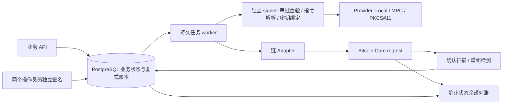
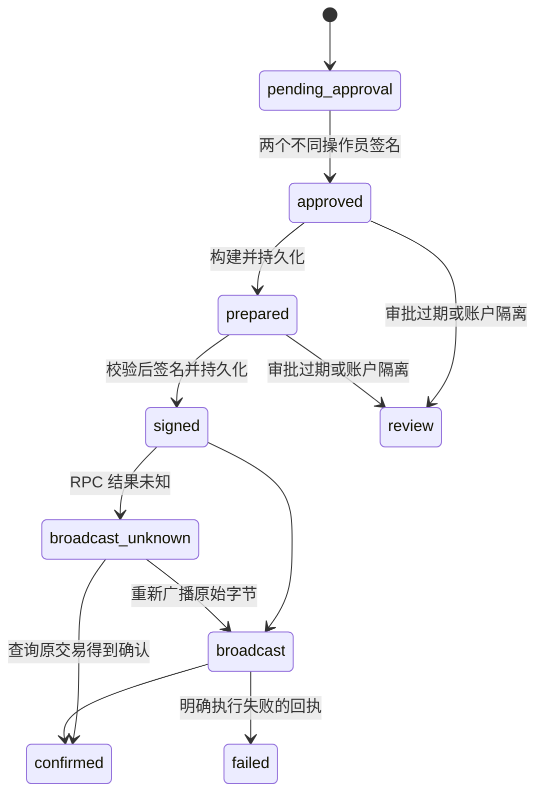

# 架构与资金安全边界

## 流程与信任边界



默认本地启动内嵌签名；可选 `cmd/signer` 使用独立 token、配置和签名去重文件。独立配置的 wallet ID → key reference → 网络与地址映射，不从请求中生成。公开接口接收完整 Prepared 与审批证明，不暴露任意 digest 签名端点。`internal/signer` 的测试覆盖审批不足、密钥替换、指令与 payload 不一致、请求变更、服务重建与认证失败。

实验进程共享开发机器，不构成物理隔离或运维人员隔离。真正部署时需分别配置密钥访问权限、操作员私钥持有者、mTLS、配置发布审批和签名服务审计存储。

## 账本

金额全程采用整数最小单位；Go 使用 big.Int，PostgreSQL 使用 NUMERIC(78,0)，API 不接受浮点。每个资产独立平衡，分录只能追加。数据库的 deferred constraint trigger 要求每个 journal 至少两条分录、合计为零；UPDATE / DELETE 被触发器拒绝。应用连接目前是本地开发库 owner，生产应拆分迁移与运行角色，限制 owner / TRUNCATE 等高权限。

| 事件 | 借方（正数） | 贷方（负数） |
|---|---|---|
| 充值确认 | 对应钱包资产 | 用户可用负债 |
| 提现申请 | 用户可用负债 | 用户冻结负债 |
| 提现成功 | 用户冻结负债 | 资金钱包资产 |
| 明确链上执行失败 | 用户冻结负债 | 用户可用负债 |
| 网络手续费 | 平台网络费用 | 支付手续费的钱包资产 |
| 归集成功 | 目标资金钱包资产 | 来源充值钱包资产 |
| 孤块充值冲正 | 用户可用负债 | 原充值钱包资产 |

用户余额是负债账户余额的相反数。归集只移动平台资产所在地址，不改变用户负债。手续费在当前模型由平台承担，不向用户二次扣款。

幂等充值键为 network + txid + event index；重组后同一交易重新进入有效块时，增加 generation，另写新 journal。冲正与重新入账保留原分录，重复扫描不重复记账。

## 交易与恢复



创建提现在用户行锁保护下检查可用负债并冻结，阻止并发超扣。审批签名绑定完整 Intent，包括 ID、网络、资产、钱包、接收方、金额、费用上限与过期时间。调用方不能用一个 actor 名称重复凑足两个审批。

Prepared 与签名结果分别持久化，实际广播总是使用数据库中首次存下来的交易。未知广播不能证明交易失败，因此不解冻、不重新选币、不创建新支付。worker 用 SKIP LOCKED、租约和 token fencing 领任务；过期任务可重领，业务操作仍通过数据库唯一约束及幂等 journal 去重。

尚未实现自动取消 / 过期解冻、链上替换交易、人工复核恢复接口和长期任务治理。审核状态保留资金，需要通过受控运维流程处理。首次资金不足的提现构建会等待充值，而非直接释放用户冻结。

## Bitcoin

适配器启动必须验证 Core 的 chain=regtest。服务生成 P2WPKH 地址，向 Core 导入不含私钥的 wpkh descriptor。Core 只提供链数据、UTXO 与广播，钱包私钥由独立 Provider 持有。

选择确认的 UTXO，在钱包行锁内持久预留到 withdrawal ID；崩溃或超时不释放。PSBT 含 WitnessUTXO，签名方检查来源脚本、完整接收方金额、自有找零、输入唯一性、SIGHASH_ALL 及费用上限，再逐输入执行本地脚本验证。序列号允许 RBF，但**未实现自动 RBF / CPFP**。当前费用按 2 sat/vB 的保守大小估计，不声称已实现动态费率服务。

扫描器记录每个有效块哈希及游标。出现分叉后回退到共同祖先，冲正失效充值，隔离该网络用户，再扫描有效分支。同一充值重新出现时用新 generation 入账，账户仍待复核。

重组验收覆盖充值冲正和重新确认。**已终态提现、平台注资及 coinbase 成熟度的全面重组补偿尚未完成**；实验资金通过成熟矿工钱包 sendtoaddress 注入。生产需要确认深度策略、终态交易审计、补偿审批和链资产变更统一索引。对账目前适用于无在途交易的静止状态，尚无按高度一致的全局快照。

## MPC / HSM / TEE

MPC 使用 tss-lib 的新鲜 DKG 与 2/3 门限 ECDSA，未关闭模数或因子证明。每个参与方保存一份独立分片，无完整钱包私钥重组步骤。当前路由与参与方在一个进程，未实现跨主机身份认证、恶意节点隔离、分片轮换、备份恢复与运维隔离。

PKCS#11 使用 EC key-pair generation 与 CKM_ECDSA，私钥设置 sensitive=true、extractable=false。软件验收覆盖实际签名、不可导出属性和错误 PIN；物理设备仍需确认 secp256k1 支持、会话容量、限流与恢复策略。SoftHSM 的宿主机管理员可访问令牌文件，不等价于硬件边界。

Nitro 校验器先验证 AWS 信任根下的证书链与 COSE ES384 签名，再核对 PCR0/1/2（拒绝全零调试测量）、一分钟新鲜度、单次 nonce、公钥和策略绑定。测试 CA 仅在包内部测试注入，生产构造不能接受任意自定义根。

当前 TEE 是**证明验证组件**，不是已部署的 enclave 签名器。还需要受支持的 AWS EC2/Nitro 环境、EIF 构建和测量、NSM / vsock、KMS RecipientAttestation、密钥备份与防回滚方案及真机验收。不能把本地测试证书当作 AWS 硬件证明。

## 独立 signer 配置

`SIGNER_BINDINGS` 指向由操作员准备的 JSON，不包含私钥：

```json
{
  "<wallet UUID>": {
    "wallet_id": "<wallet UUID>",
    "key_ref": "<opaque provisioned key reference>",
    "network": "btc-regtest",
    "address": "<corresponding bcrt1 address>"
  }
}
```

signer 环境：`SIGNER_TOKEN`（独立随机值）、`SIGNER_BINDINGS`、`APPROVER_PUBLIC_KEYS`、`SIGNER_JOURNAL`，以及 `SIGNER_KEYS_DIR`，或 `MPC_SHARE_DIR`，或 `PKCS11_MODULE / PKCS11_TOKEN / PKCS11_PIN`。API 配置 `SIGNER_URL=http://127.0.0.1:8081` 与同一 signer token。默认仅监听 loopback；跨主机部署必须增加 mTLS，当前二进制主动拒绝直接对外监听。

开发密钥保存为权限 0600 的明文文件，仅用于本地。创建钱包时，API 默认仍能接触开发密钥；独立 signer 本身的存在不能消除此访问。生产需把密钥生成和备份移入受控签名域，并让 API 仅获取公钥及 opaque reference。

## 主要参考

- [Bitcoin Core RPC 30.0](https://bitcoincore.org/en/doc/30.0.0/)
- [PSBT BIP174](https://github.com/bitcoin/bips/blob/master/bip-0174.mediawiki)
- [btcsuite PSBT 与脚本](https://github.com/btcsuite/btcd)
- [BNB Chain tss-lib](https://github.com/bnb-chain/tss-lib)
- [SoftHSM](https://github.com/softhsm/SoftHSMv2)
- [AWS Nitro 信任根与证明](https://docs.aws.amazon.com/enclaves/latest/user/verify-root.html)
- [Nitro 验证库 nitrite](https://github.com/hf/nitrite)
