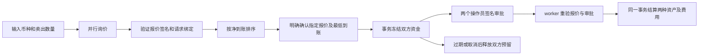

# RFQ 询价与资金结算实验

SettleForge 用 Go 和真实 PostgreSQL 实现 exact-input 询价：用户指定卖出资产与数量，并行获取两家做市商的签名报价，比较净到账量；确认后预留双方资金，经两个操作员审批后结算。

环境为 **local-simulated**。价格是固定合成数值，LABUSD 是模拟资产，未接入外部 LP、0x、实时行情或主网兑换。Ed25519 报价是本项目的实验协议，不兼容 0x / EIP-712。RFQ 不调用 BTC / MPC / PKCS#11 的链上签名 Provider，这些原有模块独立运行。

## 运行

```sh
make local-up           # 默认 RFQ_LAB=1，旧版本 API 需停止后重新启动
```

另一个终端：

```sh
make local-rfq-demo     # HTTP、CLI 双操作员审批、worker 和 PostgreSQL
make test-rfq           # 需要本地 PostgreSQL，可覆盖 TEST_DATABASE_URL
```

`make local-demo` 在原有 TRON / BTC 演示后运行 RFQ。直接启动二进制需设置 `RFQ_LAB=1`，否则 RFQ 关闭；`make local-up RFQ_LAB=0` 可明确禁用。`GET /v1/status` 返回 `rfq_mode=local-simulated` 或 `disabled`。

演示充值 3 个模拟 ETH，比较卖出 1 ETH 的报价，验证幂等确认和参数冲突，完成两次独立审批，检查 ETH 冻结归零及 LABUSD 入账，再取消一笔新交易并验证退款。报告在 `.local/rfq-http-acceptance.json`。不创建云资源，不需要行情 API Key，不使用真实资产。

## 流程



报价有效 60 秒；聚合器拒绝超过 120 秒的报价，来源查询预算 750 毫秒。单来源超时、不可用或签名不符时剔除该来源；全部失败才返回依赖不可用。来源必须遵守 context。

示例毛价格为 2500 / 2510 LABUSD 每 ETH，费用为 20 / 30 bps，均为合成数值。`buy_amount` 是扣费后的净到账量，`fee_amount` 同样以买入资产计价。排序比较净到账量，同值按 maker ID 排序。换算使用整数最小单位和 big.Int，向下取整，拒绝零到账与溢出。ETH 精度 18 位，LABUSD 精度 6 位。

询价本身不预留库存；确认报价时再次检查并冻结。系统不会自动接受最优报价，客户端需明确提交 quote_id 和 min_buy_amount。

## 模型与接口

| 模型 | 字段 |
|---|---|
| RFQRequest | 请求 ID、用户、网络、卖出资产、买入资产、卖出数量 |
| RFQOffer | 完整请求、quote_id、maker_id、净到账、费用、有效期、模式 |
| RFQQuote | Offer 与做市商 Ed25519 签名 |
| RFQTradeIntent | trade_id、用户、完整签名报价、min_buy_amount |
| RFQTrade | 不可变指令、状态、创建时间 |

| 接口 | 行为 |
|---|---|
| `POST /v1/rfq/quotes` | 并行询价、验签、保存与排名，返回 best_quote_id |
| `POST /v1/rfq/trades` | 需要 Idempotency-Key，接受报价并冻结双方资金 |
| `GET /v1/rfq/trades/{id}` | 查询完整指令与状态 |
| `POST /v1/rfq/trades/{id}/approvals` | 提交操作员对完整指令的签名 |
| `POST /v1/rfq/trades/{id}/cancel` | 取消尚未终态的交易；终态返回原状态 |

询价：

```json
{
  "user_id": "<user UUID>",
  "network": "evm-dev",
  "sell_asset": "evm-dev/ETH",
  "buy_asset": "evm-dev/LABUSD",
  "sell_amount": "1000000000000000000"
}
```

确认：

```json
{
  "user_id": "<same user UUID>",
  "quote_id": "<best_quote_id>",
  "min_buy_amount": "<minimum acceptable net buy amount>"
}
```

客户端需展示并确认模拟环境、资产、数量、费用、净到账和有效期。最低到账高于报价净到账会被拒绝。当前报价为固定数量全额成交，没有拆单和 AMM 浮动成交逻辑。接口采用现有开发管理员 Bearer token，尚无终端用户身份认证和租户隔离，user_id 表示管理员代操作的用户，不能直接对不可信客户端开放。

操作员本地读取完整交易并签名：

```sh
./bin/settleforge approve --kind rfq --id <trade UUID> --actor operator-a
./bin/settleforge approve --kind rfq --id <trade UUID> --actor operator-b
```

签名覆盖交易 ID、用户、网络、币种、数量、费用、报价有效期与签名、最低到账。报价与审批各自使用域前缀，与提现审批隔离。CLI 是实验管理工具，真实操作员还需要可信审阅界面。本机私钥文件不构成物理隔离。做市商密钥保存为 `.local/rfq-makers/` 下权限 0600 的文件；数据库固定首次公钥，拒绝重启时静默换钥。不要删除仍在使用的密钥目录来重置环境。

## 并发、状态与账本

确认时按用户、做市商顺序加行锁，检查账户状态、网络、最低到账、用户余额和做市商库存。提现与 RFQ 共用用户行锁及 available / frozen 负债账户。每个报价只能创建一笔交易；相同 user_id + Idempotency-Key 的原请求返回原交易，参数变化返回 409，成交或过期后仍能重放原请求。

状态为 `pending_approval → approved → settled`，或终态之前进入 `expired / cancelled`。同一个 actor 重复提交不能凑足两个审批。到期使用获取行锁后的数据库时间；过期审批被拒绝。worker 重启扫描已批准及已过期记录，不依赖内存队列。

| 事件 | 资产 | 借方 | 贷方 |
|---|---|---|---|
| 确认预留 | 卖出资产 | 用户可用负债 | 用户冻结负债 |
| 确认预留 | 买入资产 | 做市商可用负债 | 做市商冻结负债（净到账 + 费用） |
| 成交 | 卖出资产 | 用户冻结负债 | 做市商可用负债 |
| 成交 | 买入资产 | 做市商冻结负债 | 用户可用负债（净到账）及费用收入 |
| 取消或过期 | 两种资产分别 | 原冻结负债 | 原可用负债 |

两种资产、费用和交易终态在一个 PostgreSQL 事务中提交；崩溃只能整体提交或回滚，不会只扣一边。分录按唯一 journal ref 去重，每个资产独立平衡。做市商实验库存注入独立的 rfq-lab-inventory 资产账户，不伪装成链地址资产；RFQ 不移动链上余额，原有逐地址链对账不代表做市商库存对账。报价、交易指令及审批有数据库不可变约束。

## 验收与边界

专项测试使用真实 PostgreSQL 的独立 schema，覆盖净价排序、单来源超时、签名及字段篡改、幂等与重复消费、用户及库存不足、最低到账、双人审批、账户隔离、取消和真实时间到期、服务重建、并发 worker、反向兑换与 HTTP 全流程。故障测试在第二种资产入账时注入数据库异常，验证两边全部回滚，服务重建后可重试成功。10 ETH 余额收到 40 个各卖出 1 ETH 的并发请求，只允许接受 10 个。完整 `make local-check` 强制检查 RFQ 测试通过，缺失或跳过会失败。

接入外部做市商时，还需实现 LP 认证与协议适配、真实价格与库存、成交请求与回报、持久 outbox、查询原订单与结果未知恢复、清算及对手方对账。接入 0x / DEX 还需 ERC20 授权、spender / 目标合约白名单、calldata 解析和模拟、链上签名与广播、确认和重组补偿。**本地原子账本结算不能证明这些外部执行能力。**

简历或面试可描述为：“在个人开源项目中实现 Go / PostgreSQL RFQ 询价实验模块，支持多来源签名报价、净价比较、双边资金预留、双人审批、幂等结算及过期退款，并完成并发和故障恢复验收。”

参考：[0x Swap API 流程](https://docs.0x.org/evm/0x-swap-api/introduction)、[0x RFQ Order 字段](https://docs.0xprotocol.org/en/latest/basics/orders.html)。用于理解业务，本项目未接入这些生产协议。
